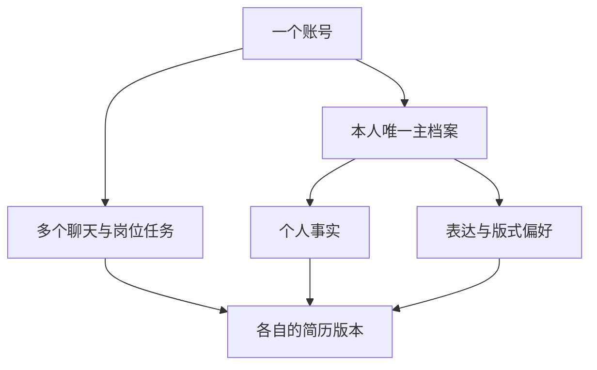

# 胡话简历产品化与个人档案开发报告

版本：v1.0　日期：2026-10-04　编写：Codex　确认人：Banz

本报告把本次讨论转成下一阶段可执行的开发方案。目标是让用户独立完成一份真实、可编辑、可导出的简历，并在同一账号下持续积累个人档案；个人信息的保存、读取、更正和删除需要可靠且受保护。

**确认状态：Banz 于 2026-10-04 以“开始吧”确认本报告，授权本地 P0–P4 实现、隔离测试与文档更新。** 下文保留确认时的现状与方案，不能作为最新完成状态；实施证据与限制见同目录的实施交付记录。真实资料迁移、外部服务开通和公开部署不在本轮执行范围。

快速审阅可先看第 1 节的需求状态、第 10 节的开发顺序，以及第 12 节的 D1–D5 默认方案。推荐先把账号归属、可靠保存和加密打稳，再接跨对话档案与建议采用；现有交互改动作为回归基线保留。

## 1 本次讨论形成的需求

| 内容 | 确认情况 | 当前实现状态 |
| --- | --- | --- |
| JD 解析、经历整理等长内容放到右侧对应卡片，左侧保留简短反馈与引导 | 已明确要求 | 已本地实现与验证 |
| 用户补充信息后，当前简历逐步更新 | 已明确要求 | 已本地实现；需要继续以真实案例验收质量 |
| 选项点击后直接发送一句完整回答，避免反复追加填空文字 | 已明确要求 | 已本地实现，包含重复点击保护和失败重试 |
| 一号一人，一个账号维护本人一份主档案 | 已确认方向 | 账号与个人主档案尚未实现 |
| 增加档案整理 Agent，汇总不同对话中的本人信息并处理更新 | 已确认方向 | 尚未实现；写入、冲突和删除细则待本报告确认 |
| 信息存取需要加密和保护 | 已确认方向 | 当前未见应用层内容加密；具体方案待本报告确认 |
| 建议采用、运行监测、真实用户测试等产品化补齐 | 本次提出的建议 | 纳入下文拟议实施范围，待确认 |

“一号一人”约束的是档案结构，不要求收集身份证或引入实名认证。用户上传的 JD、他人参考简历和示例仍是独立材料，不因来自同一个账号而成为本人事实。

## 2 当前基础与已知缺口

项目已有 FastAPI、LangGraph、数据库持久化、历史对话、六款模板、表单编辑、PDF 与 Word 导出。当前聊天通过浏览器 Cookie 的归属信息组织目录，最新简历保存在 canonical 数据中，完整对话与收集事实保存在 LangGraph checkpoint 中。

已有验证能证明部分本地流程运行正确：最近工作区整合记录包含 188 项离线 Python 回归、105 项模拟浏览器检查、13 项真实本地 API 与 SQLite 浏览器检查，以及一次虚构资料的四轮真实模型流程。随后点选回答修复通过 48 项定向 Python 和 77 项模拟浏览器检查。这些来自不同验证批次，有重叠，不能相加作为覆盖率，也不代表陌生用户体验或线上运行已通过。

本次只读核查确认的主要缺口：

- **成稿表达**：生成阶段主要摘取、排序原句；修改建议与实际简历之间缺少清楚的“核对并采用”流程。
- **账号与归属**：现有 `User`、`Conversation` 和 `ResumeSession` 尚未形成有效的账号关联；部分私有读写、删除与聊天接口未统一检查资料归属。
- **长期档案**：缺少跨对话事实 ID、逐条来源、更正记录和共享档案的并发控制。
- **加密范围**：简历 JSON、正文、会话标题、checkpoint、浏览器备份及部分日志均需纳入处理。部署平台的底层磁盘加密状态未核验。
- **运行闭环**：已有部署配置、限流和部分超时处理；线上部署、备份恢复、数据结构迁移、整轮超时和成本控制仍需补齐或验证。部分保存异常目前仅记录日志，调用者不能可靠判断是否保存成功。
- **真实效果**：尚无足够证据证明首次使用者能独立完成、愿意使用成稿或持续回来。

## 3 首期范围与暂不纳入内容

拟议首期包含五部分：账号及统一归属校验；个人档案与档案整理 Agent；加密存取及旧数据迁移；建议核对采用；最小运行保障与邀请测试准备。

个人档案提供查看、补充、更正、删除、来源查看和冲突处理。简历版本先支持按岗位保存、命名及查看档案更新提示。建议采用支持本次操作撤销；任意历史版本回滚、复杂版本比较暂不作为首期要求。

暂不纳入：一个账号维护多人档案、团队协作、自动投递、招聘方沟通、支付与订阅、跨产品记忆、自动学习或修改系统规则，以及新增 Mem0、Graphiti、Letta 等记忆框架。后续是否引入检索服务取决于实际数据规模与召回需求。

本次确认拟授权本地代码实现、隔离测试和开发文档更新。购买或开通外部服务、生产数据迁移、公开部署、收费以及联系测试用户，需要在具体对象、费用与影响明确后另行取得相应授权。

## 4 一号一人的资料结构

**个人事实**包括姓名、联系方式、教育、项目、工作或实习、技能声明，以及对应的职责、时间、交付物和真实结果。姓名归在这一类，不单独做一个记忆 Agent。

**个人偏好**包括语言、简洁程度和常用模板。用户只针对本次简历提出的要求，默认留在当前任务；明确表达长期偏好时才进入主档案。

**岗位与简历版本**保存目标 JD、选用的事实及其修订版本、具体表述、模板和确认状态。不同岗位可以强调不同内容，但不能改变底层事实。

建议新增独立 `profile_id`，与稳定账号 ID 保持一对一关系。姓名或邮箱不是资料主键；改姓名、更换登录邮箱不创建另一个人的档案。匿名浏览器历史只允许通过仍有效的原浏览器凭证，在登录后显式认领；不能仅凭姓名、邮箱文字或传入的 session_id 合并资料。

## 5 档案整理 Agent 的工作规则

推荐采用“明确且无冲突的本人信息自动整理，重要歧义让用户确认”的方式。右侧显示此次新增或更正了什么，提供修改与撤销入口，避免每句话都弹出保存确认。

Agent 每次读取新增消息、必要的临近上下文以及相关档案记录，输出结构化变更建议：新增、补充、更正、重复提及或待确认冲突。程序负责校验来源、字段、归属和版本后入库。Agent 不直接执行任意数据库操作，不接触加密密钥。

聊天本轮新信息立即参与当前回复与草稿更新。跨对话归档可在后台完成；明确更正或删除在可靠保存后立即建立失效标记，使其他对话不再取用旧值，不必等待模型完成归纳。

触发点包括已成功保存的聊天轮次和用户手动编辑。手动编辑需判断是事实更正还是当前版本的表述调整，不能把所有简历改字都当作全局事实更新。中断回复中用户已经提交并可靠保存的原话可以保留，助手未完成的建议不得作为事实来源。

首次启用时，只对用户明确认领的历史聊天做一次有进度、有来源的导入；后续只处理新增变化。来源不足或涉及他人的材料进入待确认，不默默合并。

每条事实至少记录：稳定事实 ID、所属账号及档案、关联项目或经历、内容、来源消息或手动编辑版本、来源类型、记录时间、适用时间、当前状态、修订号及替代关系。

本人自述可以作为简历材料使用，但应标明“用户提供”；不因被自动收录就显示“已独立核实”。JD、参考材料和 AI 建议不能直接进入本人事实。计划、否定和未上线等信息必须保留原义，不能转成已完成成果。

## 6 时间 更新与删除规则

| 情况 | 拟议处理 |
| --- | --- |
| 同一事实反复出现 | 合并记录，补充来源与最近提及时间；不自动提升真实性 |
| 对同一项目补充新细节 | 更新相关字段，保留其他项目和已知内容 |
| 明确纠正旧说法 | 当前有效记录使用更正值，旧记录标为被替代并停止常规召回 |
| 后来实际发生变化 | 记录新状态与适用时间，保留历史状态的时间范围 |
| 今天描述过去的情况 | 按事实发生时间归档，不覆盖更晚的当前状态 |
| 两次陈述矛盾且无法判断 | 标为待确认；展示原说法和新说法，允许保留原值、采用新值或自行更正 |
| 只从当前简历移除经历 | 只改变当前版本的选用关系，主档案保留 |
| 明确从个人档案删除 | 停止召回和生成引用，清除相应在线内容及派生索引；防止旧聊天再次导入 |

区分信息记录时间、事件发生时间和事实生效时间。用户没有提供的时间保留未知。排序与冲突判断使用这些语义和用户明确更正，不能只比较后台任务完成时间。

例如“9 月未上线，10 月已经上线”属于状态变化；10 月再次提到“8 月只有 Demo”不会把当前状态改回 Demo。“之前说负责整个项目不准确，我只负责后端”属于更正，即使旧说法出现更多次，也要停止使用旧值。

普通补充不直接改写全部旧岗位版本。当前活跃草稿按本轮意图更新，其他版本标记受影响内容并提示同步。明确纠错和删除则必须在上下文组装、历史续聊、后台任务及导出前统一检查：旧 checkpoint 和简历副本不能绕过失效标记；含已知错误或已删除内容的版本须先修正或移除相关内容，才能继续生成或导出。已下载到用户设备的文件无法远程撤回。

拟议删除范围：删除聊天时说明已经归档的个人事实是否保留；在档案中删除事实时，清除档案内容与受影响的在线简历副本，对源消息保留必要的最小禁止回收标记，并允许用户选择同时清除相关原始材料。若保留原始聊天，应明确说明这属于“删除档案并禁止再次使用”，不等于清除全部原文；保留的原文仍须从后续模型上下文排除。

备份按公开说明的期限失效。删除日志独立持久化，保留期覆盖仍可恢复的备份；恢复时核对最新删除水位，重放删除并清理派生数据，校验完成后再开放资料读取和归档任务，防止旧备份覆盖较新的删除记录。不能承诺点击删除后所有历史备份瞬间消失。具体备份与删除日志保留期限在选定部署环境后确认，首期生产发布前必须确定。

## 7 加密存取与隐私边界

保存流程为“校验身份与归属 → 校验数据 → 加密 → 提交数据库”；读取流程为“校验身份与归属 → 按权限读取密文 → 服务端解密 → 只提供本次需要的内容”。所有私有读、写、删、历史、导出和后台任务都执行同一归属规则。

推荐使用成熟库提供的认证加密，应用数据优先评估 AES-256-GCM。按库规范生成 nonce，保证同一密钥下不重复，并用账号、记录 ID、数据类型等绑定加密上下文。checkpoint 使用经验证的加密 serializer 或适配层，不自行设计加密算法，也不假定现成 serializer 会加密所有元数据。

加密与访问控制共同覆盖以下落点：

- 应用数据库里的个人事实、偏好、简历正文、会话标题及包含个人内容的来源记录。
- LangGraph checkpoint 的消息、状态和待写数据；账号 ID、会话 ID等必要元数据仍做最小化处理和访问控制。
- 数据库备份与确有必要保留的附件；上传临时磁盘缓冲要检查清理和宿主存储保护。
- 浏览器草稿和聊天副本：默认减少长期明文全文缓存，保留清楚的未保存状态与服务端恢复能力；不把固定密钥写进前端充当保护。
- 运行日志：保留操作 ID、阶段、耗时和错误类型，移除用户原文与可能复述隐私的模型理由；上线前处理已有明文日志和旧备份。

密钥与数据库分开管理，生产环境优先使用部署平台的密钥管理或秘密管理能力；具体供应商未选定。密文携带密钥版本，设计轮换、单独受控的密钥恢复、解密失败处理和旧密文迁移。缺少正确密钥时明确失败，不能自动生成新密钥后覆盖旧资料。模型 API 密钥与数据加密密钥分离。

浏览器到服务端、服务端到数据库和模型接口的生产链路均按支持情况配置 TLS 并验证证书；不以本地 localhost HTTP 预览替代线上验证。身份令牌使用安全的会话机制，配合 Cookie、CSRF 和退出登录后的缓存处理。

服务端为生成和编辑简历仍需要接触明文，本方案不属于端到端加密。模型仍会收到完成任务所需的部分经历文本；电话、邮箱等通常无需交给模型，可在程序渲染模板时补入。普通 PDF、Word 和用户主动下载的草稿是独立文件，应明确下载后由用户设备管理。

第一版按账号、记录类型和项目 ID读取相关记录，授权解密后再挑选上下文。暂不为跨用户检索建立明文或向量索引；将来引入检索系统时，需要重新审查数据泄露面和删除传播。

## 8 建议采用与现有交互保护

拟议补上“原句—建议句—修改说明—采用或保留”的操作。仅依据已有事实的表达改进可以采用；涉及新增职责、数字或成果的内容必须先补事实或确认，不能直接写入。

采用后同一份 canonical 简历、预览、保存稿与导出保持一致，并能撤销本次采用。表达变化更新岗位版本；用户确认了新的事实时，再单独更新个人档案，避免 AI 措辞反向污染事实库。

本次已实现的右侧工作页、逐轮增量更新、点选即发送完整回答、原输入草稿和附件保留均作为回归基线。冲突确认也采用简短选项与自由输入；选择结果须绑定具体事实与修订版本，旧卡片不能覆盖新版本。

## 9 技术落点与运行保障

建议沿用 FastAPI、LangGraph 和现有数据库路线，建立统一的档案服务、访问控制和加密持久层。结构化事实表为权威数据源；若使用 LangGraph Store，只作为同一数据的存取适配或可重建索引，避免维护两份独立真相。

新增数据结构的具体命名可在实施时调整，但职责需清楚：一对一账号档案、逐条事实与修订、来源关联、待确认冲突、岗位简历引用、整理任务以及删除标记。来源正文与变更内容属于加密范围。

后台整理采用可持久化任务，使用消息 ID 或编辑事件 ID 去重。业务保存与任务登记须在同一事务中完成，或通过持久事件与补偿扫描覆盖不同存储的提交边界；不能在“资料已保存、任务未登记”的崩溃点丢失归档。任务可失败重试、显示待处理状态。按档案版本处理并发冲突，执行前再次核对权限、来源状态与删除标记；旧任务不得覆盖新更正或恢复已删除内容。

现有接入点包括 `resume_graph` 的轮次保存、`canonical_resume` 的表单保存、`session_store` 的持久化，以及 `main.py` 的 checkpoint 初始化。需要先修正保存失败只记录日志的问题，让前端、归档任务和导出能够区分成功与失败。加解密封装在统一持久层，不能只改一个保存函数而漏掉直接 ORM 写入。

运行保障首期包括：明确整轮超时、模型调用并发上限、预算与限额反馈；失败可恢复且不重复写入；数据库迁移版本；重启与备份恢复演练；包含数据库可用性的健康检查；不含正文的操作结果、延迟、保存状态和模型用量记录。日志及指标遵循最小化采集，不记录完整聊天作为分析埋点。

## 10 拟议实施顺序与交付门槛

| 阶段 | 主要工作 | 阶段通过标准 |
| --- | --- | --- |
| P0 基线与迁移准备 | 固定已有改动和回归基线，建立迁移方案，备份并验证恢复 | 可识别本次改动范围，可在隔离副本重现与恢复；未损坏既有草稿 |
| P1 账号与安全存取 | 登录接入、统一归属、加密层、checkpoint、缓存与日志调整 | 全部私有接口拒绝跨账号访问；抽样数据落盘无明文；轮换与解密失败可控 |
| P2 个人档案 | 一号一人、事实来源与时间、增量整理、冲突、更正和删除 | 跨聊天复用正确，旧值不复活，同账号并发可控，归档失败可见 |
| P3 成稿采用 | 原句对照、采用、撤销、岗位版本同步提示 | 建议正确进入当前简历，预览与导出一致，不新增无来源事实 |
| P4 试用准备 | 运行监测、限额、部署与恢复方案、真实用户验收脚本 | 技术验收通过且发布配置可核查；具备邀请测试条件 |
| P5 邀请测试 | 经明确授权后，邀请 5–10 位目标用户独立操作 | 记录完成情况、阻塞点、事实问题、时间与成本，按结果决定下一轮 |

P1 至 P3先以隔离数据实现与验证，再迁移已授权的真实数据。可并行做界面与规则设计，但身份、加密存取和保存成功信号是跨会话档案的前置。公开开放必须经过统一归属、安全存取和恢复能力的验收。

本报告不给出未经验证的工期承诺。登录与部署供应商、现有数据规模、真实案例质量会影响工作量；确认后先拆成能独立验收的小任务，再给阶段进度。

## 11 验收案例

以下是拟议验收标准，不是已通过结果。

| 编号 | 场景与通过要求 |
| --- | --- |
| A01 | 账号 A 与 B 的聊天、档案、简历、导出和删除相互隔离；即使知道对方资料 ID也不能访问 |
| A02 | 原匿名历史只能由持有有效原浏览器凭证的用户认领；重复认领和跨账号认领被阻止 |
| M01 | 会话 A补充项目，会话 B能取到正确事实和来源；不会混入 JD、参考简历或 AI 建议 |
| M02 | 多次重复同一信息不生成重复经历，不因次数而提高事实确认状态 |
| M03 | “负责人”更正为“后端参与者”后，新生成只使用更正值；旧版本显示同步提示 |
| M04 | 后来提及早期 Demo，不覆盖已经确认的后续上线状态；未知时间不被补造 |
| M05 | 两个聊天同时更新同一项目时，不丢失已确认内容；冲突明确呈现而非静默覆盖 |
| M06 | 后台中断、重试和重复事件只应用一次；模拟业务提交后任务登记前崩溃，仍可补偿归档；用户能区分聊天已保存和档案待整理 |
| M07 | 删除档案事实后，再打开旧聊天、执行旧任务或恢复备份，都不会重新召回该事实 |
| M08 | 从一份简历移除经历不删除主档案；引用事实发生更正时，其他版本能识别受影响内容 |
| S01 | 用虚构姓名与电话作为检查标记，核对应用表、checkpoint、备份、浏览器缓存及日志的预期保护范围，无遗漏的长期明文副本 |
| S02 | 密文篡改或绑定到错误账号、记录时被拒绝；缺密钥、密钥轮换和恢复演练均不覆盖旧数据 |
| S03 | 旧数据迁移可在隔离副本中断后恢复，重复运行不重复加密；回滚路径受控，旧明文副本按策略清理 |
| U01 | 选项连续点击只发送一次完整回答，失败可重试，草稿与附件保留；过期冲突选项不可覆盖新事实 |
| U02 | 采用或撤销建议后，当前简历、保存稿、刷新恢复与实际 PDF 和 Word 的内容一致 |
| U03 | 在上传、回复、保存、归档阶段分别制造失败，用户能恢复，资料不丢失、不重复、不伪报成功 |
| O01 | 本地阶段在隔离环境完成重启、迁移、备份恢复与导出演练，验证成本限额、并发及错误监测；获得部署授权后，发布前在目标环境重新验收 |
| Q01 | 至少 10 组脱敏素材做来源级核对，生成内容不擅自升级职责、数字和成果；通过固定案例不外推为全面准确 |
| Q02 | 经授权邀请 5–10 位目标用户，从旧稿或零散经历开始，无代操作地补齐一段本人经历、核对当前稿并成功导出；记录完成比例、时长、卡点、成稿修改量、是否愿意使用和单次成本 |

技术验收通过不等于求职效果已经证明。首期不承诺面试率、ATS 分数或“绝对安全”；真实试用后再设有依据的体验目标和收费方案。

## 12 建议一并确认的默认方案

确认整份报告表示接受下列推荐值；如有不同意见，可以只指出对应编号，其他内容保留。

| 决策 | 推荐值 | 取舍 |
| --- | --- | --- |
| D1 档案写入 | 明确本人信息自动整理，冲突或归属不明再确认 | 减少操作，但需要来源、可见变更和撤销保障 |
| D2 首期登录 | 先支持一种邮箱验证码或登录链接方式，供应商另行核对 | 降低密码管理负担；仍需邮件发送、登录限额和账号恢复能力 |
| D3 留存与删除 | 档案默认持续保留至用户删除；聊天删除与档案删除分开说明 | 支持长期复用，同时必须实现来源解绑、禁止回收与备份到期规则 |
| D4 加密实施 | 应用层认证加密覆盖持久化内容，配合 TLS、独立密钥管理和访问控制 | 增加迁移和运维工作，不提供端到端加密承诺 |
| D5 首期范围 | 按 P0 至 P4完成本地实现与验证，准备小范围 beta；P5外联与公开发布另授权 | 先得到可验收版本，暂不增加支付、多人档案或复杂记忆框架 |

报告确认后，供应商开通、费用、备份期限及生产迁移对象仍须形成具体配置或操作说明；不以报告中的候选方案代替这些实际条件。无法立即满足外部条件时，先完成不依赖它们的本地实现，并明确待接入项。

## 13 依据与交付状态

项目依据：本次对话、`mmr.md`、`backend/app/models/models.py`、`backend/app/services/conversation_store.py`、`session_store.py`、`canonical_resume.py`、`backend/app/agents/resume_graph.py`、`editor_chain.py`、`triage_chain.py`、`backend/main.py`、`web/conversation-history.js` 与 `web/resume-editor.js`。本次代码核查未读取真实用户数据库或凭证。

已有验证记录：`evaluation/live-workspace-2026-10-04/verification.json`、`evaluation/quick-replies-2026-10-04/verification.json` 和 `evaluation/personal-flow-2026-10-02/report.md`。这些记录提供已执行范围，不把旧批次测试数视为本方案的验收结果。

技术参考：[LangGraph 记忆概览](https://docs.langchain.com/oss/python/concepts/memory)、[LangGraph Store](https://docs.langchain.com/oss/python/langgraph/stores)、[LangGraph 持久化](https://docs.langchain.com/oss/python/langgraph/persistence)、[OWASP 存储加密指南](https://cheatsheetseries.owasp.org/cheatsheets/Cryptographic_Storage_Cheat_Sheet.html)、[OWASP 浏览器存储指南](https://cheatsheetseries.owasp.org/cheatsheets/HTML5_Security_Cheat_Sheet.html)。本报告的产品规则与实施排序是结合项目的建议，不是这些文档对产品效果的保证。

**交付状态：报告待确认，下一阶段代码开发未开始。**
