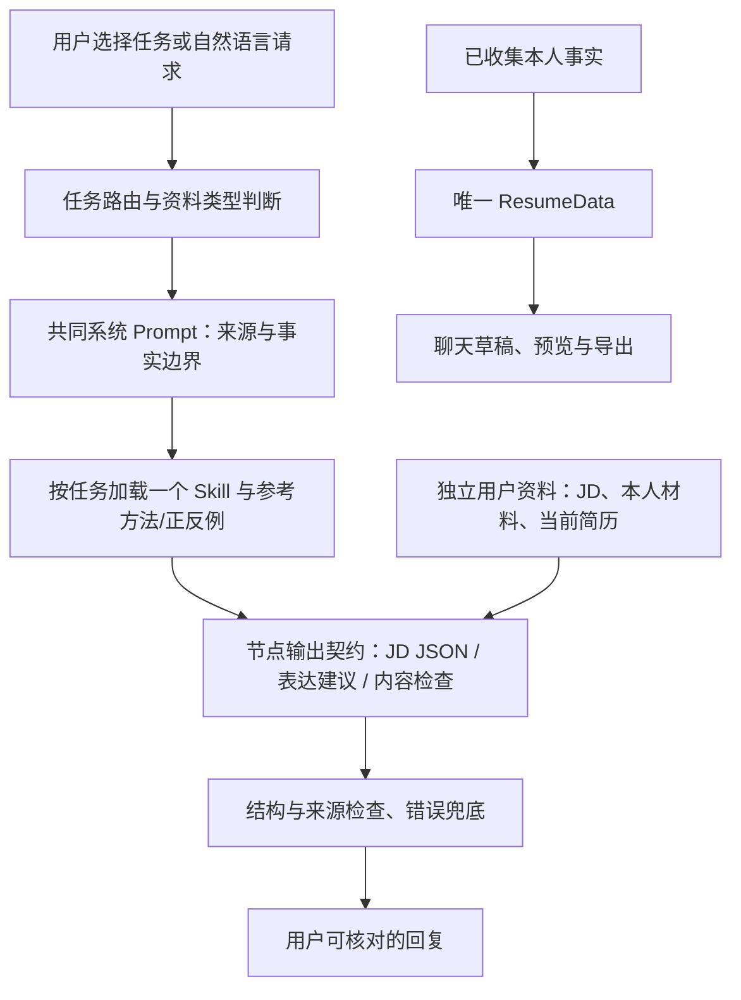

# 胡话简历：求职专用 Skill 与系统 Prompt

更新：2026-10-02。当前版本：`career-v1.4-2026-10-02`。

## 专业能力具体落在哪里

目标是更准确地判断「岗位要什么、本人做过什么、缺什么证据、怎么写清楚」。角色名和资料数量本身不能证明效果，需比较输出并保留失败案例。

| 功能 | 专业方法 | 不足时的动作 |
| --- | --- | --- |
| 解码 JD | 职责、必要条件、加分项、申请资格分开；重要要求有原文定位；文化用语给待确认问题 | 短 JD 不凑条数，申请窗口未知不判资格 |
| 包装经历 | 本人动作、方法、交付物与结果；个人/团队、参与/主导、Demo/上线分别核对；按岗位改变强调点 | 先问个人贡献，缺指标可写真实交付物，不先补造成果 |
| 检查简历 | 事实/资格 → 岗位证据 → 表达；定位原句，给修改动作；技能声明不等于经验 | 缺事实先追问，不生成含新动作的正文或填空范例；无 JD 做通用检查 |

资料依据包括 Harvard、Princeton、U-M Career Center/HR、Greenhouse 官方文档与两家公司的具体校招信息。公司资格窗口只作为研究反例，**不固化为所有公司的规则**。详细支持范围与原始链接见 [JD/检查资料](references/jd-review-sources.md) 和 [经历/Prompt 资料](references/writing-prompt-sources.md)。

## 四层设计

1. **共同系统规则**：来源、职责程度、团队主体、完成状态、数字、未知与材料指令边界。
2. **任务 Skill**：只加载当前功能的入口、方法与正反例，不把三个全文都塞给每轮对话。
3. **节点契约**：JD 输出兼容原字段并加原句证据；路由返回决策；编辑器只摘取原句和归组；检查输出问题位置、依据与修改动作。
4. **独立资料消息**：招聘要求、本人自述、已有事实、当前简历分别标识。分隔消息有助于表达边界，但不能单独证明防住全部提示注入。

共同 Prompt 的实际定义在 `backend/app/agents/career_prompt.py`，三个项目内 Skill 在 `backend/app/agents/skills/`。宿主直接按允许的任务名加载这些文件；不是安装到个人 Codex 的全局 Skill。

## 当前实现

- 三快捷按钮实际传递 `decode_jd / rewrite_experience / review_resume`，任务对下一次提交生效；后续恢复 `auto`。首次检查已有简历不要求先走 JD 收集。
- 当前主链是 `resume_graph`；JD、经历对话、提取、路由、编辑与专业检查使用共同系统规则。旧 `orchestrator` 的调优/评分 Prompt 不在网页主链，不能作为当前效果证据。
- JD 解码验证 JSON 形状及证据原句是否存在；空结果/错误保留原有 JD。原句定位通过不等于语义分类必然正确。
- 自动识别的 JD 记录消息排除 ID，显式检查材料带类型；两者不会被历史兜底重新采集成个人经历或可选基本信息。误贴示例/招聘资料及否定/将来描述不进入确定性项目兜底。
- 专业检查读取完整当前结构化数据和本轮材料，只返回建议，不写入个人事实或替换草稿。基础规则检查仍保留。
- **包装文字仍是候选建议**；导出继续使用原有事实与摘取校验，不自动把模型改写当事实。后续若做「核对并采用建议」，应另加采用与来源契约。
- 产品长期记忆仍为待选方案，本次没有接入。

## 效果验证

固定 8 个虚构风险案例，使用同一 `deepseek-flash`、温度 0、相同输入和输出契约。对照为合理的通用助手 Prompt（要求准确、不编造）与专业系统 Prompt + Skill；每组各一次。A/B 随机标记，独立 agent 仅读取盲输出作语义复核。

这验证的是固定案例中的专业行为，不是完整网站效果、真实用户反馈、ATS 解析、投递成功率或统计显著性。案例与 Skill 的风险设计相关，不能视为独立公开基准。

首轮独立 agent 盲评在 6/8 组偏好专业版本；另 2 组两边都有事实错误，不能算胜出。这是 agent 在固定虚构案例中的判断，没有人工评分或统计显著性证据。

首轮发现「核对 → 处理/去重」、自行补招新场景、未经验证的投递率和普遍手机号要求等问题，已用于修订 v1.1。3 个针对性复测通过原验收条件，但复核又发现「不同工具完全不相关」「缺教育信息无法投递」等过度判断；v1.2 修订后发现填空范例仍补出新动作。v1.3 将检查职责收紧为问题、依据、修改动作与必要追问，成稿交给包装任务。最终针对该案例的独立复核通过，原始错误和每次复测均保留。

这轮累计 21 次组件模型调用（首轮 16 次，针对性复测 3+1+1 次），均为虚构材料。针对失败案例的修订与复测有助于修复已知问题，不能证明所有输入都优于通用 AI。最终仍需真实脱敏材料和人工核对。

网页另做 35 项模拟 API 的浏览器断言，覆盖任务选择、失败保留、成功恢复自动和新对话清除。实际本地 HTTP/SSE 使用独立虚构会话：JD 与检查不污染本人数据；发现原型经历在模型提取被来源校验拒绝后会漏收，已补原文兜底及否定/计划反例。实际回复还暴露「画界面 → 可交互原型」的属性夸大，v1.4 补充该边界与正反例。每个测试会话均在测试后删除；接口路由成功不等于每条改写的语义必然正确。

v1.4 实际原型复测的主推荐句通过独立来源复核；可选句的「供课程评阅」用途未由输入明确提供，整段严格语义结果记为 `partial_pass`，建议使用主句并删除该推断。快照保留原文，尚含聊天请求语句与通用项目名，不能据此声称改写已经进入最终导出。这些是当前的实际限制，后续需验证采用建议与成稿流程。

记录位置：

- `evaluation/career-v1/cases.json`：固定输入和验收条件。
- `evaluation/career-v1/results/blind-outputs.json`：首轮原始输出、耗时与 token。
- `evaluation/career-v1/results/blind-review.json`：独立语义复核。
- `evaluation/career-v1/retest/`：v1.1 针对实际失败的复测。
- `evaluation/career-v1/retest-v1.2/` 与 `retest-v1.3/`：后续修订的原始输出与独立复核。
- `evaluation/career-v1/frontend-smoke.json`：35 项浏览器断言，业务 API 使用模拟响应。
- `evaluation/career-v1/local-flow-initial.json` 与 `local-flow-retest-v1.3.json`：实际接口发现的漏收与语义问题。
- `evaluation/career-v1/local-flow-retest.json`：最新原型经历接口复测。
- `evaluation/career-v1/local-flow-semantic-review.json`：实际回复的独立语义复核，区分主推荐句与可选句。

离线检查：`.venv/bin/python evaluation/eval_career_prompts.py`。
真实对照需显式 `--live`，默认最多 16 次调用，无重试、并行 2、每次 40 秒/1400 token 上限；只发虚构案例，不操作用户简历或会话数据库。

## 后续选择

优先用 3–5 位真实求职者的脱敏材料验证：是否问到了有用事实、建议能否直接使用、最终导出是否保留真实职责与限制。再决定采用建议的交互和经历库规则。不要把增加资料、框架或角色设定当作已超过普通 AI 的证明。
